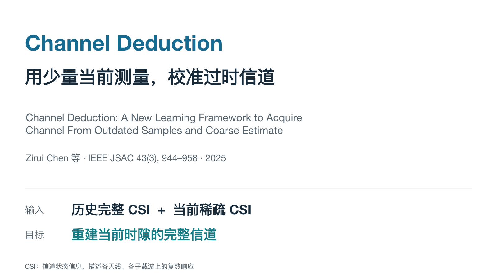
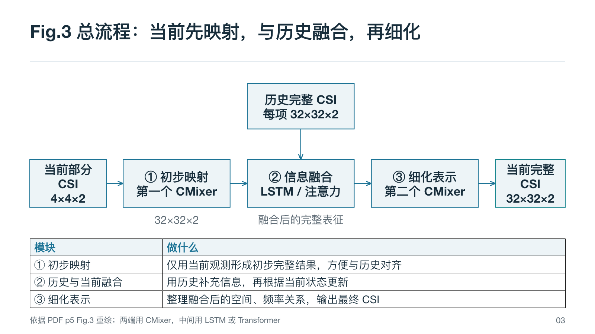
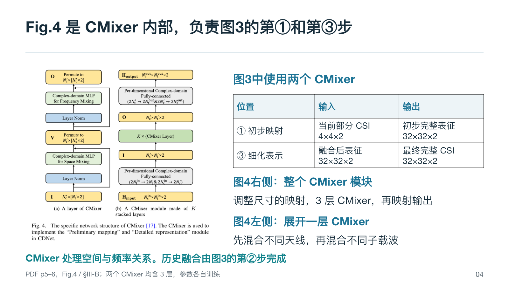
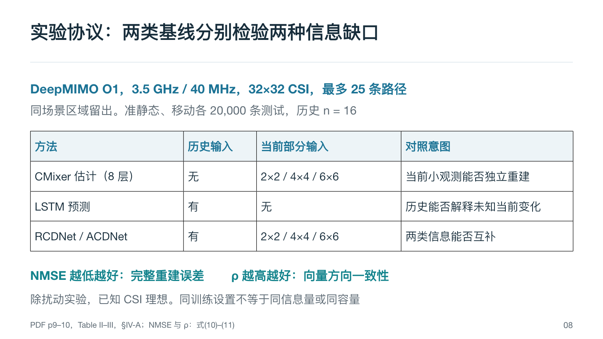
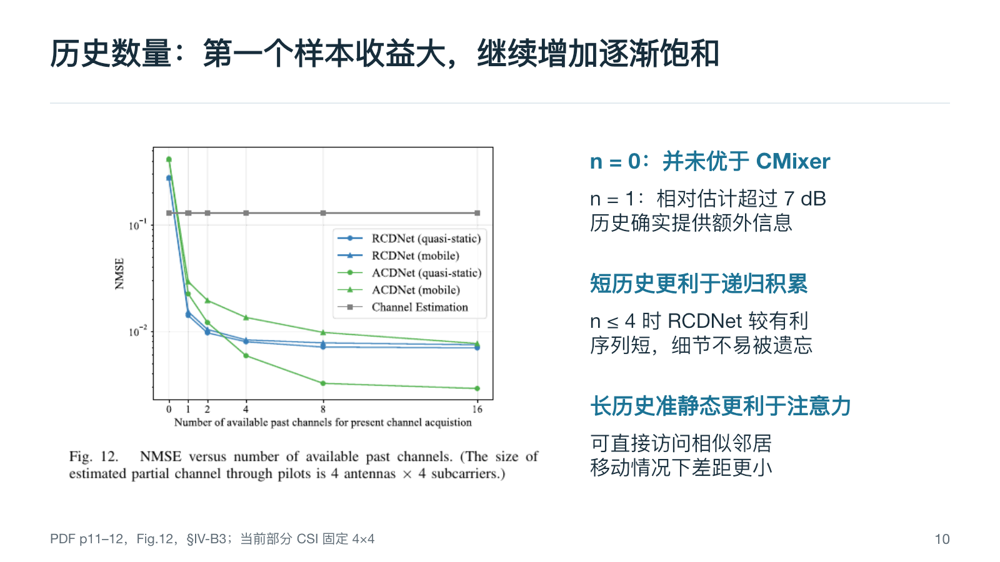

# Academic Paper Talk

**从一篇论文，制作讲清科学问题、方法机制和实验证据的简洁学术 PPT。**

[English](README.en.md) · [使用指南](docs/usage.md) · [内容与质量标准](docs/quality.md) · [贡献指南](CONTRIBUTING.md)

这是一个可安装的 Codex skill。它将论文阅读、汇报组织、PowerPoint 制作和逐页检查连接起来，默认使用中文讲稿与必要的 English 专业术语。上传全文 PDF 后，用一句话启动，得到可编辑 PPTX、逐页朗读稿和大纲。

## 参考风格



白底、深蓝文字、克制的蓝青强调。保留可读的论文原图，以原生流程图和表格解释关键关系。图片中的 Channel Deduction 是参考案例，新汇报会使用新论文的内容。

## 它会讲清什么

| 环节 | 具体要求 |
| --- | --- |
| 问题与 Spark | 作者发现了什么矛盾，关键观察为什么有价值 |
| 贡献定位 | 最接近的方法已经做到哪里，本文具体推进了什么 |
| 总体流程 | 谁在何时观察什么，输入如何变为输出，侧信息和反馈在哪里进入 |
| 模块与公式 | 每一步的输入、处理、输出、必要性，以及关键变量的含义 |
| 一次运行 | 带着一个样本走过计算、状态更新、下一步与停止规则 |
| 实验 | baseline 的输入与资源、坐标与指标、结果、原因和结论范围 |
| 研究启发 | 哪个真实瓶颈值得继续验证，怎样用最小实验检验 |

每页 speaker notes 都是**可直接朗读的完整口播**。出处放页脚或来源附录，备注里不混入时长、操作提示和问答提纲。页数按论文、时长和用户要求调整。

## 安装

需要 Python 3.10+。下载或 clone 本仓库后，在仓库目录运行：

```bash
python3 scripts/install.py
```

默认安装到 `${CODEX_HOME:-~/.codex}/skills/artifact-template-academic-paper-talk`。已有同名 skill 时会停止，避免覆盖个人修改。确认更新时执行：

```bash
python3 scripts/install.py --force
```

旧版会先备份到 skills 目录同级的 `skill-backups/`。自定义安装目录可用 `--skills-dir /path/to/skills`。也可以手动复制 `skills/artifact-template-academic-paper-talk/` 整个目录。若当前会话未发现新 skill，重新打开会话后再调用。

## 使用

上传论文全文 PDF，然后输入：

> 使用 $artifact-template-academic-paper-talk 制作这篇论文的中文精读 PPT。重点讲清 Spark、总体流程、关键公式和实验，备注写成可直接朗读的讲稿。

也可以指定“15 分钟”“总共 10 页含封面”“重点解释算法”“沿用我上传的导师模板”，或提供已有 PPT 进行修改。只提供 DOI 或链接时，agent 会先获取全文；无法获取时会请求可用来源。

默认交付：

- `论文简称_精读汇报.pptx`
- `逐页朗读稿.md`
- `逐页大纲.md`

制作依赖当前 Codex 的 **Presentations** 能力和文档工具。仓库本身不包含模型服务、演示文稿运行库或一键离线 PPT 生成器。检查脚本独立使用 Python 标准库，不需要 API key。

## 页面示例

| 总体流程 | 模块展开 |
| --- | --- |
|  |  |

| 基线协议 | 结果解释 |
| --- | --- |
|  |  |

## 自动检查

```bash
python3 scripts/check_package.py
python3 -m unittest discover -s tests -v
python3 skills/artifact-template-academic-paper-talk/scripts/audit_pptx.py report.pptx --script 逐页朗读稿.md --out audit.json
```

检查内容包括备注缺失、讲稿不同步、提示标签残留，以及原生表格和连接对象计数。**结构检查不能证明论文事实正确或页面可读**；完整制作流程还要求核对原文，并从最终 PPTX 渲染、逐页查看。

## 仓库结构

```text
skills/artifact-template-academic-paper-talk/
  SKILL.md                 核心流程和触发条件
  artifact-template.json   模板元数据
  agents/openai.yaml       Codex 展示与调用配置
  assets/                  参考 PPT、封面预览和页面示例
  references/              拆解、版式、验收和经验指南
  scripts/audit_pptx.py    成品结构与备注检查
scripts/                   安装与包完整性检查
tests/                     安装与检查工具的回归测试
docs/                      使用与质量说明
```

## 来源与许可

流程来自多轮论文精读汇报实践，涵盖 Coded Beam Training、Channel Deduction、Near-Optimal NFBT、Distance-Dependent Beam Split、AMBER 和 ChannelLM。经验说明见 [provenance](skills/artifact-template-academic-paper-talk/references/provenance.md)。

原创说明和代码采用 [MIT License](LICENSE)。参考 PPT 和图片中包含第三方论文内容，相关权利归原作者或出版方；这些材料不在 MIT 授权范围内，详见 [第三方材料说明](THIRD_PARTY_NOTICES.md)。
